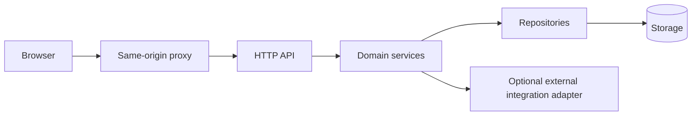

# Project architecture and onboarding template

Copy this document into a new repository, replace every bracketed placeholder and delete inapplicable sections. It is an architecture/onboarding document template, not executable scaffolding or a guarantee that its proposed controls already exist. Companion implementation standards are the [backend](../coding-practices/BACKEND_CODING_PRACTICES.md) and [frontend](../coding-practices/FRONTEND_CODING_PRACTICES.md) practice guides.

Separate **implemented**, **planned**, **recommended** and **unverified** statements. Do not copy Resume Tailor's accepted feature inventory, historical test counts, local-owner identity or runtime pins as universal requirements. Choose the next project's actual versions and security scope before implementing its first vertical slice.

---

## 1. Document ownership and reading order

| Field | Value |
|---|---|
| Project / purpose | [name and one-sentence user problem] |
| Intended developers | [expected stack/domain familiarity] |
| Maintainer | [team/role] |
| Source revision reviewed | [commit/tag; if none, dated working-tree review] |
| Last source verification | [date] |
| Supported deployment | [local single-owner / authenticated private server / public multi-user] |
| Current release scope | [implemented capability list] |
| Explicit future scope | [planned capability list] |

Reading order: [setup] -> [this overview] -> [backend guide] -> [frontend guide] -> [domain rules] -> [security/operations] -> [decisions and evidence].

Keep a short root README linking to setup and deeper guides. Preserve a decision log and dated verification evidence. Historical plans should be labeled so they cannot be mistaken for current implementation.

## 2. Product vocabulary and invariants

Define domain terms before framework choices. For each object, identify who owns it, which fields are authoritative and when it can change.

| Term / entity | Meaning | Owner | Authoritative fields | Mutation/history rule |
|---|---|---|---|---|
| [Project] | [meaning] | [user/team/workspace] | [fields] | [mutable/revisioned/snapshots] |
| [Submission] | [meaning] | [owner] | [fields] | [exact historical artifact] |

Write invariants as concrete failure-prevention rules:

- [A request cannot select another owner's object by supplying its ID.]
- [An accepted submission refers to an exact saved version.]
- [A delayed result cannot persist after access is revoked.]
- [An external integration receives only configured/authorized data.]

For each invariant, link to the implementation and a meaningful test. If no mechanism/test exists, mark it planned or unresolved.

## 3. Technology adoption record

| Concern | Choice/version | Reason | Rejected alternative | Upgrade/validation gate |
|---|---|---|---|---|
| Backend language/runtime | [choose] | [reason] | [alternative] | [gate] |
| HTTP framework | [choose] | [reason] | [alternative] | [gate] |
| Database and migration tool | [choose] | [reason] | [alternative] | [gate] |
| Frontend runtime/framework | [choose] | [reason] | [alternative] | [gate] |
| Router/server-state library | [choose] | [reason] | [alternative] | [gate] |
| Forms/local state | [native or library, with demonstrated need] | [reason] | [alternative] | [gate] |
| CSS/components | [choose] | [reason] | [alternative] | [gate] |
| Contracts/client generation | [choose] | [reason] | [alternative] | [gate] |
| Workers/cache | [none/in-process/distributed] | [reason] | [alternative] | [gate] |
| Packaging/proxy | [choose] | [reason] | [alternative] | [gate] |
| Tests/quality tooling | [choose] | [reason] | [alternative] | [gate] |

Record dependency manifests, lockfiles, exact supported runtime/package-manager versions and installation commands. Distinguish a broad package engine range from an exact release baseline if both exist. Do not add Redis, vector search, AI, encryption layers or a global store unless a real requirement justifies them.

## 4. Runtime and trust boundary diagram

Replace this illustrative diagram with actual processes and access boundaries:



For every arrow, document protocol, identity, timeout/cancellation, data sensitivity and failure behavior. Identify which boxes are packages versus separate processes. State published bind addresses, proxy routing, TLS termination and supported process/replica count. A local identity shortcut is not public-server authentication.

## 5. Backend organization

This is a suggested starting layout for a domain-based Python API; adapt it explicitly if the selected stack differs:

```text
backend/
  app/
    main.py                 factory, route assembly and lifespan
    core/                   configuration, engine/session and shared policy mechanisms
    projects/
      schemas.py            typed inputs/outputs and structural validation
      models.py             mapped tables, indexes and constraints
      router.py             HTTP adaptation and dependencies
      service.py            business use cases and state transitions
      repository.py         queries and conditional persistence
    integrations/           external I/O adapters, if required
  migrations/               explicit ordered schema evolution
  tests/                    isolated synthetic fixtures and regression coverage
```

Document the permitted dependency direction, the real exceptions and why they exist. Choose whether services use transport-neutral exceptions or framework errors; do not claim purity while relying on HTTP types everywhere. Choose whether repositories return DTOs or mapped objects and how implicit/lazy reads are prevented across boundaries.

### Layer contract

| Layer | Allowed responsibility | Prohibited responsibility |
|---|---|---|
| Router | Request/response, dependencies, status, file/stream framing | Product decisions, SQL, direct provider calls |
| Service | Business rules, authorization decisions, orchestration | Hidden SQL and alternate integration paths |
| Repository | Owner-scoped reads, conditional writes, explicit serialization | UI formatting and provider inference |
| Schemas | Shape/bounds/enums/structural validation | Pretending an ID proves ownership |
| Infrastructure | Resource lifecycle, configured policy enforcement | Becoming a shared home for every product use case |

### Required backend explanation

For each domain, provide: purpose, routes, input/output contracts, tables, use cases, dependencies, transaction owner, ownership rules, immutable records, cancellation/recovery and export/delete obligations. Include one real linked function in each layer. Explain framework dependency injection and resource cleanup from app startup through request completion/shutdown.

## 6. Persistence and concurrency contract

Fill in each decision before writes are implemented:

| Decision | Project answer |
|---|---|
| ID/owner representation | [answer] |
| Foreign-key/owner-pair integrity | [answer] |
| Transaction/commit owner | [answer; document nested helper behavior] |
| DTO serialization boundary | [answer] |
| Mutable versus append-only data | [answer] |
| Stale-write detection | [expected revision + conditional write, or justified alternative] |
| Retry/idempotency semantics | [answer, including historical return identity] |
| Deletion/retirement and relationships | [answer] |
| Migration/backfill/downgrade policy | [answer] |
| Post-await current-state rechecks | [answer] |
| Revocation of pending reads/writes/streams | [answer] |
| Encryption/keys/backup/restore | [answer or explicit not required] |

Include a concrete race: two clients read revision 4, one saves revision 5, the other receives [conflict behavior]. Explain the exact storage condition that makes this atomic. Include one delayed-operation example: a task starts, source/access changes, and the final write is [revalidated/rejected]. Disabled UI buttons alone cannot enforce either rule.

## 7. Frontend organization and state contract

An illustrative growing-project layout:

```text
frontend/src/
  app/                      root providers, router and layout
  api/                      shared typed transport and generated contracts
  features/projects/
    ProjectPage.tsx         route orchestration
    ProjectForm.tsx         controlled draft UI
    api.ts                  typed feature requests
    queries.ts              query identity/options if useful
    model.ts                pure feature transformations if needed
  shared/                   genuinely shared UI/resource helpers
  styles/                   declared styling strategy
  test/                     shared test setup
```

For a small app, a flat page layout may be sufficient. Select the actual structure and document it; do not describe this proposed tree as implemented until it exists.

| State kind | Chosen owner | Persistence/lifetime | Reset/invalidation rule |
|---|---|---|---|
| Server result | [query/cache layer] | [memory/persistent policy] | [keys/invalidation] |
| Unsaved draft | [page/form/store] | [lifetime] | [explicit open/save/discard] |
| URL selection | [router/search params] | [bookmark behavior] | [validation/fallback] |
| Derived values | [computed] | [none] | [inputs] |
| Resource handles | [ref/effect/hook] | [mount/operation] | [cleanup] |
| Access state | [gate/session owner] | [scope] | [revoke/reset] |

Explain provider order, page routes, error boundaries, query defaults, generated type imports, mutation handling, query keys and accessible empty/error/loading states. Document how a save response avoids overwriting edits made while the request is pending. If autosave exists, specify first-save behavior, debounce, overlap, versioning and conflict recovery separately.

## 8. One complete vertical slice

Replace this illustrative `Project` example with actual source links after implementation:

1. A labeled form collects `name`; draft state belongs to [component].
2. Submit converts UI values into [request schema].
3. [Typed client helper] calls POST [route].
4. [Dependency] resolves authenticated owner/workspace; it is not accepted as a trusted body field.
5. [Service] checks [business invariant].
6. [Repository] writes the owner-scoped row under [transaction rules].
7. [Database constraints] enforce [uniqueness/relationships].
8. The response returns [DTO/revision].
9. [Mutation handler] updates baseline and invalidates [query keys].
10. Failures [preserve draft/show field errors/conflict recovery].

Include request/response examples with synthetic values, one invalid-input example, one forbidden-owner example and one stale-write example. Link executable tests. Mark snippets as excerpts versus illustrative pseudocode, so readers do not mistake an incomplete sketch for production-ready code.

## 9. Optional long-running work and integrations

Delete this section if unnecessary. Otherwise choose request-owned versus persisted-run behavior explicitly. Specify admission limits, active concurrency, task states, timeout, browser disconnect, explicit cancellation, partial results, restart recovery, result identity, stream protocol, heartbeat and replay cursor.

For every external integration, document consent/authorization, destination validation, secret handling, data minimization, logging, retry bounds, idempotency and configuration invalidation. A schema-valid response is not automatically a business-valid result. AI-enabled projects need separate evidence/claim rules and synthetic model evaluation; applications without AI need no speculative AI gateway.

File/browser/subprocess operations need real resource bounds and a stated containment model. Interpreter isolation, disabled page JavaScript or offline routing should not be labeled OS sandboxing. If exports/previews exist, define exact-version identity, fonts/assets, cache key/invalidation and which environments have real visual verification.

## 10. Security and complete data lifecycle

Document authentication, authorization, ownership, request-origin/CSRF policy, cookies, CORS, trusted hosts, body limits, CSP, secret storage and logging. Explain which mechanisms are applicable to the actual deployment; do not copy a local passcode as a public account system.

For each entity/file/run/cache, specify creation, retention, update/history, export, delete, backup and delayed-result behavior. New tables/files must be integrated into those operations. Distinguish storage encryption, session unlocking, external copies and key recovery. Record known gaps as findings with owner, impact and acceptance tests instead of burying them in a historical note.

## 11. Testing and evidence matrix

| Boundary | Command / test | Fixture/store | Environment | What a pass proves | What it does not prove |
|---|---|---|---|---|---|
| Unit/domain | [command] | [synthetic] | [runtime] | [claim] | [limit] |
| API/storage/migrations | [command] | [disposable DB] | [dialect/runtime] | [claim] | [other dialects] |
| Frontend components | [command] | [mock API] | [jsdom] | [claim] | [real layout/browser] |
| Browser journey | [command] | [isolated server/store] | [browser] | [claim] | [model quality] |
| Generated contract drift | [command] | [no personal data] | [tools] | [claim] | [runtime semantics] |
| Dependency audit | [command] | [lockfiles] | [advisory timestamp] | [known-advisory result] | [absence of all vulnerabilities] |
| Production/container | [command] | [isolated services] | [images/proxy] | [claim] | [hosted run/account login] |
| Clean installation | [command] | [fresh source/env] | [host/cache assumptions] | [claim] | [physical clean OS unless performed] |

Every release note should record exact commands/results, original failures and retests, runtime/provider/image versions where relevant, and unresolved environments. Never convert “CI configured” into “CI passed.” Use synthetic fixtures; product/personal stores are not test data.

## 12. Operations and contributor workflow

Record setup, first migration, routine start/restart, bind addresses, environment keys, health/doctor, stop, backup/restore, upgrade and rollback. Explain where data physically lives and how native/container/test installations differ. Troubleshooting should map symptoms to checks: proxy, process, database, migration, key, provider and viewer are different failure classes.

A normal contribution should:

1. Read domain rules/decisions and define the invariant/change scope.
2. Implement the smallest complete vertical slice.
3. Apply explicit schema evolution and regenerate contracts where required.
4. Preserve revision/history/access/retention boundaries.
5. Verify behavior at the changed boundaries and record actual evidence.
6. Update architecture/operations/decisions/known issues with the implementation.

## 13. Onboarding acceptance

A developer should be able to locate and explain:

- One full UI -> request -> service -> repository -> storage -> UI flow.
- Owner/access resolution and an ownership-failure test.
- The distinction between a schema, database model, server snapshot and editable draft.
- Transaction ownership, stale-write behavior and historical artifact identity.
- Where requests/resources are cancelled and how delayed results are rejected.
- Which files are generated and how drift is checked.
- One real browser/production check beyond mocked tests.
- Supported deployment limits and current unresolved findings.

Review this document against source after the first feature and after architecture changes. An accurate smaller handbook is preferable to a detailed description of a system that was never implemented.
