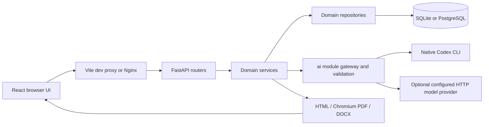

# Developer onboarding and architecture handbook

Source review: 2026-10-15. This handbook explains the implemented Phase 0-6 application. It is a reading companion to the code, not a replacement for contracts, migrations or tests. Later roadmap features remain proposals. No runtime change is introduced by these documents.

## Reading order

1. Read this overview for the product vocabulary, runtime boundaries and cross-stack workflows.
2. Read [Backend implementation](BACKEND.md), following the linked source files while reading.
   Use the [backend concepts reading list](BACKEND_READING_LIST.md) for prerequisite topics and learning goals organized by the same section numbers.
3. Read [Frontend implementation](FRONTEND.md), especially state ownership, API calls and editing races.
4. Read [the security audit](../release/security-audit-2026-10-09.md) before changing privacy, streaming, parsing, rendering or deployment.
5. Use [the new-project architecture template](PROJECT_ARCHITECTURE_TEMPLATE.md) with the existing [coding-practice guides](../coding-practices/README.md) when starting another project.

For setup and routine restarts, use [the root README](../../README.md) and [Windows operations](../run-windows.md). Use an isolated synthetic database for onboarding experiments. Setup, migration, doctor and model evaluation are real operations; understand their selected database and side effects before running them. Reading the source requires none of those operations.

## 1. Which document answers which question?

| Document | Purpose |
|---|---|
| [AGENTS.md](../../AGENTS.md) | Mandatory repository rules and session constraints |
| [PROJECT.md](../../PROJECT.md) | Preserved original blueprint, ordered roadmap and appended scope decisions |
| [IMPLEMENTATION_STATUS.md](../../IMPLEMENTATION_STATUS.md) | Acceptance evidence, failures/retests and environment limitations |
| [ARCHITECTURE.md](../../ARCHITECTURE.md) | Historical architectural evolution; early statements describe their phase |
| [DECISIONS.md](../../DECISIONS.md) | Reasons for choices and rejected alternatives |
| [SKILLS.md](../../SKILLS.md) | Maintenance/tooling knowledge from previous sessions |
| This handbook | Current code navigation, implementation mechanics and change recipes |
| [Coding practices](../coding-practices/README.md) | Independently reusable standards for future projects |

The original blueprint recommends some libraries and infrastructure that were never adopted. The current frontend uses ordinary CSS and controlled React inputs, not Tailwind/shadcn, React Hook Form, Zod, Zustand, TipTap or dnd-kit. The backend uses a local in-process generation worker, not a Redis queue consumer. Retrieval compares portable cached vectors in Python, not a pgvector/sqlite-vec index. Codex replaced the original default local-model setup; optional HTTP providers remain. Read installed manifests and actual imports before assuming a blueprint recommendation exists.

Historical statements such as “history is future work” in an early phase record are not the current feature inventory. Later implementation records and current source establish the implemented scope. Conversely, the presence of a roadmap table does not establish implementation.

## 2. What the application does

The application stores career facts, lets an owner assemble resumes manually, optionally proposes sourced text using configured AI, renders documents, preserves historical artifacts, evaluates deterministic ATS heuristics and tracks applications. Phase 6 adds staged resume imports, a profile question helper, sourced cover letters, evaluated prompt preferences, semantic DOCX export and bounded custom templates.

The strongest design boundary is between **facts**, **content**, **presentation** and **external processing**:

| Concept | Examples | Authority |
|---|---|---|
| Career facts | Employer, role, dates, achievements, declared metrics, skills | Stored owner-scoped records; profile changes need user confirmation |
| Document content | Header, ordered sections/items, text, source references, locks | Validated document snapshots |
| Presentation | Template, font, spacing, safe local assets | Built-in registry or immutable custom-template snapshot |
| AI proposal | Rewrite, summary, ranking, extracted candidate | Untrusted until schemas, evidence checks and applicable review succeed |
| Historical artifact | Resume/letter version, submitted application version | Exact saved version; later edits do not rewrite it |

Three meanings of “version” must stay distinct: `schema_version` identifies the document format; `version_number` counts saved document snapshots; a review/configuration revision prevents stale decisions. Prompt versions and engine/check versions describe how an output was produced. None is a substitute for the others.

## 3. Repository map

```text
backend/
  app/
    main.py                 app factory, resource lifespan, middleware, route assembly
    __main__.py             native Uvicorn entry point
    core/                   settings, engines, epochs, encryption, HTTP/file infrastructure
    <domain>/               schemas, models, router, service, repository where applicable
    ai/                     all inference adapters, prompts, evidence/retrieval/evaluation
    rendering/              database-free HTML/PDF and semantic DOCX output
  migrations/               Alembic environment and ordered schema revisions
  tests/                    synthetic domain, integration and regression tests
  pyproject.toml            Python compatibility, tooling and dependency declarations
  requirements.lock         resolved Python installation set
frontend/
  src/
    main.tsx                React root, query client, browser router
    App.tsx                 workspace shell, navigation and route table
    *Page.tsx               route-level feature UI and state
    api/                    generated contracts plus handwritten request adapters
    PdfPreview.tsx          locally bundled PDF.js viewer
    WorkspaceGate.tsx       lock status, private-cache removal, inactivity handling
    styles.css              shared application CSS
    *.test.tsx              component/workflow tests
  package.json              scripts and exact direct dependencies
  pnpm-lock.yaml            resolved JavaScript installation set
  nginx.conf                production SPA, API proxy, SSE and browser policy
scripts/                    setup/check/contracts/evaluation/e2e/install workflows
docs/                       design, onboarding, operations, practices and audits
compose.yaml                Nginx/frontend, backend, PostgreSQL, Redis
.github/workflows/ci.yml     hosted checks and separate Compose smoke definition
```

Ignore `.venv`, `node_modules`, `dist`, `.validation` and personal stores when learning the source layout. `.validation` is ignored evidence/test material; it is not an application module. A developer's database or environment file must never become a fixture.

## 4. Runtime and trust boundaries



The diagram shows logical responsibilities, not separate microservices. The backend is one Python application. A service may coordinate other domain services and typed results. Repositories own database queries; rendering owns no database session. The frontend never directly queries storage or invokes a model provider.

Native development normally has Vite and Python on separate loopback ports, joined by a same-origin `/api` proxy. The existing saved-work instructions use frontend 5180 and backend 8010; first-time defaults are 5173/8000. Compose uses a separate PostgreSQL store. Changing a port does not move data; starting another installation does not select the old store automatically.

The supported workspace is local and single-owner. `APP_MODE=server` is a guard condition, not a complete public-server implementation. Owner columns and constraints prepare isolation boundaries but do not establish public authentication. Compose's internal `0.0.0.0` backend binding enables container networking; its published host ports still bind to loopback. Redis is provisioned but does not run the generation queue.

## 5. Principles and the concrete code that enforces them

| Principle | Mechanism | Why it matters when changing code |
|---|---|---|
| Organize business behavior by domain | Each backend domain has its own contract/service/repository | Avoid global CRUD helpers that erase different ownership and review rules |
| Keep transport, decisions and queries separate | Router -> service -> repository | HTTP concerns should not become a second implementation of a use case |
| Validate at every relevant boundary | Pydantic, service rules, SQL constraints, model-output checks | A TypeScript type or plausible model response cannot establish runtime truth |
| Preserve source authority | `source_refs`, active owner/parent checks, hydrated display facts | A client cannot replace employers/dates by changing snapshot fields |
| Preserve history | Append-only document/prompt/template versions and exact artifact links | An application must keep the resume actually submitted |
| Make races visible | Expected versions/revisions, conditional SQL updates, source rechecks | Disable-button UI cannot prevent another request or tab winning a race |
| Bound expensive work | AI admission, generation limit, renderer semaphore, request/file limits | Long requests cannot consume unbounded local resources |
| Revoke pending work | Workspace epochs, guarded sessions, cancellation and cache invalidation | Lock/delete must affect already-started operations as well as new requests |
| Prefer deterministic computation | Keyword matching, numeric claim checks, actual page counts, ATS engine | Model text is unsuitable as the authority for counting, access or factual identity |
| Keep external disclosure explicit | Configured consent, `ai` boundary, backend-only secrets | Local storage and optional remote processing are separate privacy choices |

Revocation is an intended invariant with a known gap: the October 9 audit reproduced automatic session expiry failing to advance the workspace epoch. Explicit lock/delete barriers are implemented; existing streams/bound work can outlive automatic expiry. Preserve and fix this behavior deliberately rather than describing the system as fully revocation-safe. See the audit for reproduction and required regression coverage.

## 6. Trace a normal career save

1. [`CareerPage.tsx`](../../frontend/src/CareerPage.tsx) reads the category from the route. Its keyed editor resets category-local state when that category changes.
2. Queries fetch form descriptions and active career history. Form descriptions come from backend Pydantic fields; they are not database schema introspection in the browser.
3. Controlled input strings/booleans are converted into a discriminated `CareerInput` object on submit.
4. [`api/workspace.ts`](../../frontend/src/api/workspace.ts) chooses POST or PUT using the generated client.
5. FastAPI parses the input and resolves the local owner and request session through dependency injection.
6. [`career/service.py`](../../backend/app/career/service.py) checks referenced parent records and business relationships.
7. [`career/repository.py`](../../backend/app/career/repository.py) maps the closed type registry to the correct table, writes it and serializes a typed response. SQL constraints add another integrity boundary.
8. The mutation invalidates the `['history']` query and closes the form on success. An error leaves the editor available for correction.

Notice what crosses each boundary: a UI draft becomes a request contract; the request becomes validated domain data; the repository returns a contract rather than exposing arbitrary database columns. The owner comes from the backend dependency, not a client field.

## 7. Trace an editor save and preview

[`ResumePage.tsx`](../../frontend/src/ResumePage.tsx) keeps the editable document separately from the last saved response. A 600 ms debounce requests an actual PDF preview. Preview is a computation, not a save: it must not append versions.

For a save, the request contains `expected_version`. [`resumes/service.py`](../../backend/app/resumes/service.py) validates sources, reconstructs protected factual display fields and distinguishes new manual content from retained AI-origin content. A no-op save returns the existing snapshot. [`resumes/repository.py`](../../backend/app/resumes/repository.py) conditionally advances the current document number and inserts a full hashed snapshot in one transaction. A stale write produces 409 instead of silently replacing newer work.

After the first explicit save, valid dirty edits may autosave after 1.8 seconds. If the user types during a request, the successful response updates the saved baseline without replacing those newer content edits. Preview cancellation, autosave timing and server revision checks solve different problems; all three are necessary.

The rendering service generates HTML from validated structured content, prints it in Chromium and counts the resulting PDF pages. PDF.js draws those bytes in the browser. The HTML alternative is continuous layout, so it is not a pagination guarantee. Historical download selects stored version facts, including facts whose source was later retired.

## 8. Trace AI work and review

Job analysis is request-owned: a POST stream carries progress/results, and disconnect cancels the task. Its validated analysis cache may remain useful, but matching is recomputed against current career evidence.

Resume generation is persisted: creating a run returns its identity, a local worker writes checkpoints/suggestions, and the browser observes through SSE plus polling. Losing the browser does not cancel that run. Restart retains partial evidence and marks interrupted work failed rather than claiming it resumed automatically.

Both paths reach models only through `ai`. Structured output validation is followed by task-specific evidence checks. Generation protects locked content, checks source membership/numbers/claim vocabulary, requests a separate verifier opinion and fits against real PDF measurements. A verifier is a conservative additional check, not a proof of arbitrary semantic truth.

The review screen edits decisions, not the master. Acceptance/confirmed edits must pass current source and revision checks again before a separate tailored document is saved. The committed generation run retains the exact saved version. Later edits to that document cannot change the generation run's original download.

Codex is an external processing option even when its CLI is installed locally. The adapter uses CLI-owned ChatGPT authentication without extracting tokens. Consent, configured model, bounded subprocess behavior and tool restrictions are application concerns. Codex controls sampling/output length; `default` is not a resolved pinned model. See the backend guide for the source boundary rather than treating app installation as disclosure consent.

## 9. Trace Phase 6 features

| Workflow | Main sequence | Boundary to preserve |
|---|---|---|
| Import | Bounded parse -> persisted candidates/excerpts -> review -> atomic career graph commit | Candidate IDs are not career IDs; remap accepted parents transactionally; no default original-file retention |
| Profile | Select active evidence -> bounded questions -> user answers -> explicit confirmation | AI asks; the user supplies facts; recheck source revision before writing |
| Cover letter | Selected current evidence -> paragraph proposals/verifier -> review -> separate version | Exact application/letter version links and later retirement-safe historical output |
| Prompt playground | Immutable bounded preferences -> synthetic baseline/candidate evaluation -> guarded activation | A passing report must match the exact configuration; system guardrails are not freely editable |
| Template | Safe declaration/PNG assets -> real synthetic PDF measurement -> immutable version | No arbitrary executable HTML/CSS; snapshot presentation/assets for historical exports |
| DOCX | Exact saved content -> semantic OOXML | Unsupported custom layouts are refused; editability does not promise PDF pagination |

## 10. First-week source-reading exercises

These exercises can be completed read-only; practical experiments should use synthetic data.

1. Find where `Owner` is resolved. Explain why putting `user_id` in a request would not be equivalent.
2. Follow one achievement from `CareerInput` through the parent XOR validator, service parent check and database constraints.
3. Follow `saveResume` through a stale `expected_version`. Identify the SQL condition that makes the check atomic.
4. Explain why changing a source record does not rewrite an old downloaded resume, but can invalidate a new review commit.
5. Compare job-analysis POST streaming with generation EventSource observation. Predict which survives tab closure.
6. Find every consumer of `workspace-locked` and describe which private browser caches are removed.
7. Find the renderer cache epoch and explain how it rejects a late insertion after invalidation.
8. Read a focused backend regression and a frontend test, then identify what requires a real PDF/browser/model/environment check beyond them.

An onboarded developer should be able to answer each with file/function names and a concrete failure scenario, rather than only repeating the principles.

## 11. Making a change across the stack

1. Read the repository rules, current implementation evidence and relevant domain source/tests.
2. Write the use case and invariants: owner, sources, mutable versus historical data, concurrent writes, cancellation, export/delete and error recovery.
3. Change schemas/models/migrations only where required; let the service own decisions and repositories own SQL.
4. Register new models/router/privacy lifecycle integration where needed.
5. Regenerate contracts with `python scripts/tasks.py api` when contracts change. Never hand-edit generated files.
6. Add or adapt request wrappers and integrate the page's query/draft/mutation state. Plan failure, empty and conflict states as part of the feature.
7. Verify the risky boundaries with synthetic fixtures. Run the required checks appropriate to the change; rendering changes require actual PDF/browser evidence.
8. Update these explanations when the architecture changes, record decisions/evidence, and maintain all six session-ending documents required by repository rules.

Use [the backend change checklist](BACKEND.md#14-change-and-review-recipes) and [the frontend checklist](FRONTEND.md#13-change-and-review-recipes) for implementation details. The reusable architecture template captures the same questions without carrying this product's entities into every new project.

## UI style and refinement

The [UI/UX style specification](../design/UI_UX_STYLE_GUIDE.md) and [portable starter](../design/ui-starter/index.html) define the implemented style for reuse. The [Phase 7 plan](../design/07-ui-refinement-plan.md) is preserved history, and the [clean UI design process](../coding-practices/CLEAN_UI_DESIGN_PROCESS.md) provides the general workflow.

For Phase 7 UI work, read [shared UI components](UI_COMPONENTS.md), [implementation evidence](../design/07-ui-implementation.md) and [Apple website research](../design/apple-website-ui-analysis.md).
